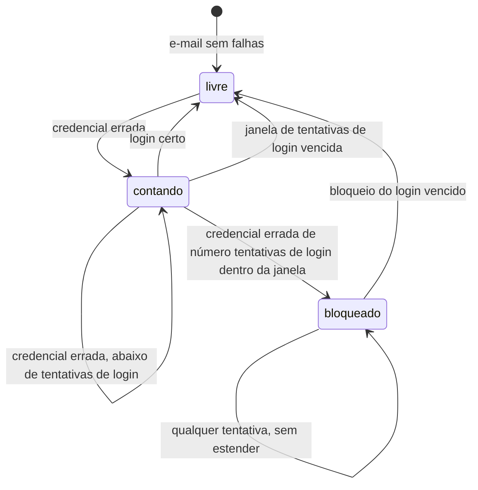
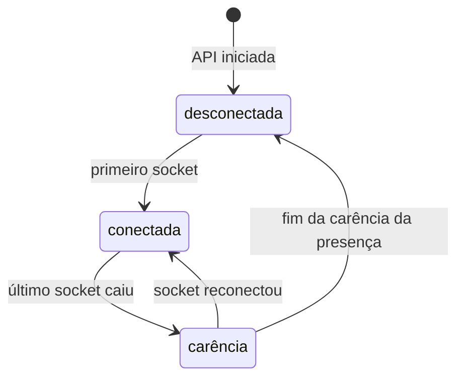
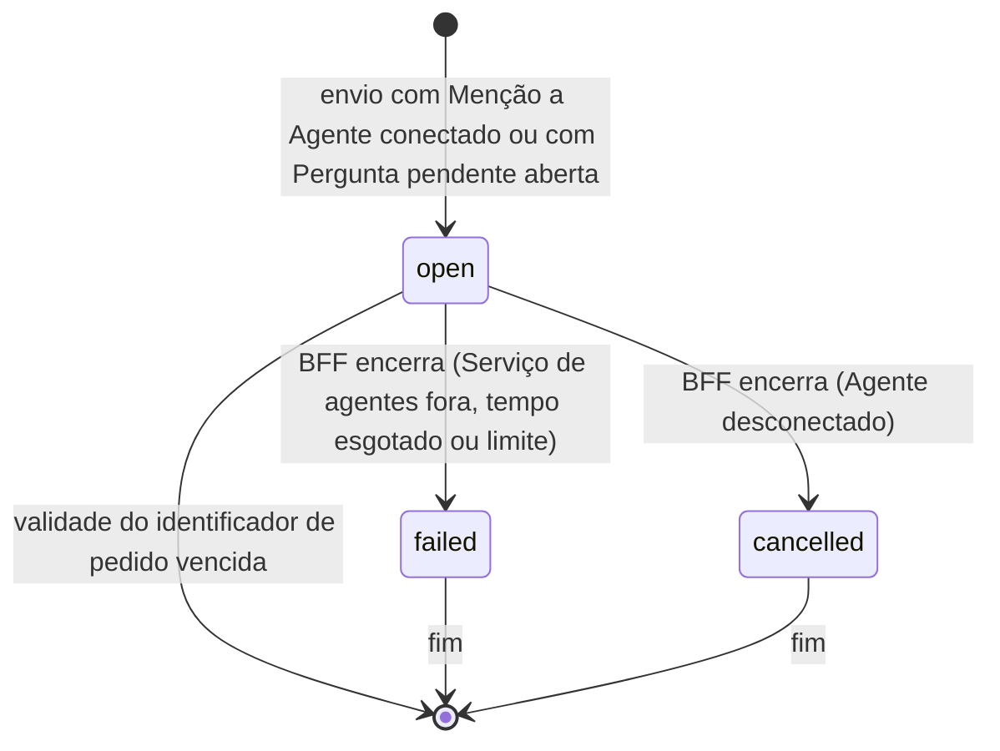

# LLD — Developer Chat Chat

2026-11-12 · Eduardl Developer · Status: rascunho · HLD: [hld.md](hld.md)

**Onde mora cada fato**

| Fato | Dono |
| --- | --- |
| Arquitetura, contêineres, integrações e motivos | [HLD](hld.md) |
| Decisões com porquê | `docs/adr/`, com o índice na seção "Decisões" deste documento e do HLD |
| Escopo e público | [Product brief](product-brief.md) |
| Vocabulário | `GLOSSARY.md` na raiz |
| Linguagem visual (cores, componentes, microtexto) | [Figma](https://www.figma.com/design/plW17JDOoRHydUJIIi2u87/slack) |
| Contrato REST da API do chat | `apps/chat-api/openapi.json`, gerado pelo `@nestjs/swagger` (planejado) |
| Contrato REST do Serviço de agentes | `apps/agents/openapi.json`, gerado pelo FastAPI (planejado) |
| Catálogo de códigos de erro | Os snapshots OpenAPI, como enum na resposta de erro de cada rota (planejado) |
| Eventos do WebSocket | Tipos TypeScript em `packages/chat-events/` |
| Schema do Banco do chat | `apps/chat-api/migrations/`, migrações do TypeORM |
| Schema do Banco dos agentes | `apps/agents/migrations/`, migrações do Alembic; as tabelas de sessão são do ADK |
| Schema do Banco de negócio | Script de carga em `apps/agents/scripts/` (planejado) |
| Schema das variáveis de ambiente | O schema zod do módulo de configuração de cada projeto TypeScript (`apps/chat-api/src/config/env.schema.ts` e `apps/web/src/app/config/env.ts` existem); do projeto `agents`, `apps/agents/app/config.py` (existe) |
| Práticas e comandos | `apps/*/AGENTS.md`, um por app, apontados pelo `AGENTS.md` da raiz |

Os snapshots OpenAPI ficam gravados no repositório, e a CI falha quando o código muda o contrato
sem atualizar o snapshot.

## 1. Estrutura do código

Um repositório com três aplicações implantadas separadamente (HLD, seção 5) e um pacote de tipos
compartilhado. `web`, `chat-api` e `chat-events` são projetos pnpm independentes, cada um com o
seu lockfile, sem workspace ([ADR 0017](adr/0017-projetos-pnpm-independentes.md)); `chat-events`
entra em `web` e em `chat-api` como dependência `file:../../packages/chat-events`, e uma mudança
nele exige reinstalar nos dois projetos. O projeto `agents` é gerenciado pelo uv.

```
apps/
  web/            Frontend/BFF (Next.js)                              existe
  chat-api/       API do chat (NestJS): REST, WebSocket e o comando   existe
                  de contas e permissões (HLD, seção 2)
    migrations/   migrações do Banco do chat                          existe
  agents/         Serviço de agentes e Worker (Python + ADK),         existe (Worker
                  dois processos do mesmo projeto                     planejado)
    app/          o Serviço de agentes: o app HTTP (fast_api_app)     existe
      agents/     um agente por pasta (seção "Componentes e           existe
                  dependências")
      registry/   catálogo e registro de agentes conectados           existe
      agent_requests/
                  rota de Pedido e execução do Pedido (spec da F11)   existe
      chat_api.py cliente da API do chat, com a credencial de bot     existe
    migrations/   migrações do Banco dos agentes (Alembic)            existe
    tests/        unit/, integration/ e eval/                         existe
    scripts/      script de carga do Banco de negócio                 planejada
packages/
  chat-events/    tipos dos eventos do WebSocket, usados por          existe
                  chat-api e web
docs/             HLD, LLD, ADRs, brief
```

| Papel | Escolha | Por quê |
| --- | --- | --- |
| Frontend/BFF | Next.js com App Router | Next.js: HLD, seção 5 ([ADR 0002](adr/0002-next-bff-websocket-direto.md)); App Router: a definir |
| Mutações do navegador ao BFF | Server Actions | Checagem de `Origin` do próprio Next contra CSRF, formulário que funciona por teclado e nenhuma rota REST a manter para o navegador |
| Leituras no cliente que o tempo real altera | SWR | O cache recebe os eventos do WebSocket direto, sem nova requisição, e a primeira página vem do servidor como `fallbackData` ("Cliente", "Leituras e tempo real") |
| Tempo real, no servidor e no cliente | Socket.IO | [ADR 0019](adr/0019-socket-io-tempo-real.md) |
| Cliente do Redis na API do chat | `redis` (node-redis) | Cliente oficial do Redis |
| API do chat | NestJS | HLD, seção 5 |
| ORM e migrações do Banco do chat | TypeORM | [ADR 0018](adr/0018-typeorm-api-do-chat.md) |
| Transação entre módulos na API do chat | `@nestjs-cls/transactional`, com o adaptador do TypeORM | A transação passa de um service a outro pelo contexto, sem levar o `EntityManager` à mão nem importar o repositório de outro módulo |
| Snapshot do contrato da API do chat | `@nestjs/swagger` | Gera o OpenAPI a partir do código |
| Hash de senha | Argon2id | Primeira recomendação da OWASP para senhas |
| Testes de ponta a ponta do `web` | Playwright, só no Chromium em modo headless, com `@axe-core/playwright` | Prova os fluxos pela tela, com a web e a API reais, e é o seam dos fluxos da web; o produto é só para navegador de desktop |
| Testes de unidade do `web` | Vitest, em ambiente Node, só para funções puras com muitos casos | Provar dezenas de casos de data e de texto (agrupamento, divisor de dia, links, contagem de caracteres) pelo navegador seria lento; o Playwright continua provando os fluxos |
| Gerenciador dos projetos TypeScript | pnpm, um projeto por pasta, sem workspace | [ADR 0017](adr/0017-projetos-pnpm-independentes.md) |
| Agentes | Python + Google ADK | [ADR 0003](adr/0003-agentes-python-google-adk.md) |
| Projeto do Serviço de agentes | Gerado pelo `agents-cli` 1.13 (modelo `adk_python`, protótipo, sem alvo de implantação), que fica como dependência de desenvolvimento | Traz o app HTTP, os testes e a avaliação no padrão do ADK; sem Terraform nem CI/CD do Google Cloud, porque a implantação é numa PaaS ([ADR 0004](adr/0004-paas-banco-gerenciado.md)) |
| HTTP do Serviço de agentes | FastAPI com as rotas próprias `/v1`. Com `ADK_DEV_ROUTES` verdadeiro, só no desenvolvimento, o app é o do `get_fast_api_app` do ADK, com as rotas genéricas e a interface web, e o router `/v1` entra nele; senão, é um `FastAPI` só com `/v1` e `GET /health` ([spec da F10](funcionalidades/10-conexao-de-agentes/spec.md), seção "Rotas e credencial") | O `get_fast_api_app` sempre monta as rotas genéricas (`/run`, `/apps/...`), que rodam um agente sem credencial, sem conferência de conexão e sem limite de pedidos; o parâmetro `web` só liga a interface |
| Gerenciador do projeto Python | uv | O `agents-cli` gera e opera o projeto com uv (install, lint, eval) |
| Avaliação dos agentes | `adk eval` do ADK, com um evalset e um `test_config.json` por agente em `tests/eval/<agente>/`, e o juiz LLM pelo Google AI Studio | O `agents-cli eval grade` exige credencial padrão do Google Cloud (ADC) mesmo com métrica local, e o projeto não usa o Google Cloud; os critérios que delegam ao Vertex (`safety_v1`, `multi_turn_*`) ficam de fora |
| Sessões do ADK | `DatabaseSessionService` do ADK no Banco dos agentes, pela variável `SESSION_SERVICE_URI` (driver asyncpg) | O ADK cria e mantém as tabelas de sessão; sem a variável, as sessões ficam em memória |
| Fila de pedidos demorados | A definir | — |
| Acesso ao modelo, trocável por configuração (HLD, seção 2) | A variável `AGENT_MODEL`: um valor começando com `gemini`, sem barra, usa o Gemini nativo do ADK e precisa ser um modelo que aceita o nível de raciocínio mínimo do `teto de custo por pedido` (o `gemini-3.6-flash`, padrão do ambiente, aceita; o `gemini-3.8-flash` e os anteriores ao Gemini 3 o recusam, e com eles todo Pedido falha); `openai/<modelo>` e `anthropic/<modelo>` usam o `LiteLlm` (`litellm>=1.84`); outro valor faz a configuração falhar com `AGENT_MODEL`. Todo agente pega o modelo do `build_model()` de `app/model.py`, `existe` ([spec da F11](funcionalidades/11-resumo-de-conversa-pelo-agente/spec.md), seção "Modelo de IA") | O caminho principal fica nativo e com as tentativas do ADK; no Python, OpenAI e Anthropic só existem pelo `LiteLlm`; descartado: `LiteLlm` para os três |
| Cliente do Redis no Serviço de agentes | `redis` (redis-py), pelo `redis.asyncio`, `existe` (spec da F11, seção "Rota de Pedido") | O limite de pedidos por pessoa; cliente oficial do Redis, assíncrono como o app HTTP |
| Geração do PDF | A definir | — |
| Acesso ao Banco dos agentes e migrações | SQLAlchemy assíncrono (Core), com asyncpg, e Alembic; o `env.py` do Alembic ignora as tabelas de sessão do ADK | O ADK já usa SQLAlchemy com asyncpg nas sessões, e o Alembic dá dono ao schema desse banco; descartado: SQL cru com arquivos `.sql` numerados |
| Validação das variáveis de ambiente | zod, com `@nestjs/config` na API do chat; `pydantic-settings` no projeto `agents` | Valida e tipa numa peça só em cada projeto |
| Validação de entrada na API do chat | `class-validator` e `class-transformer`, no `ValidationPipe` do Nest | Caminho padrão do Nest, e o `@nestjs/swagger` lê os mesmos decorators para gerar o snapshot OpenAPI; descartado: zod com `nestjs-zod` |
| Parser da conferência de somente leitura | A definir | — |
| Log estruturado | A definir | — |

## 2. Componentes e dependências

Os tipos de peça de cada aplicação, o que cada tipo pode chamar e o diagrama das dependências
permitidas estão a definir, assim como os módulos de domínio da API do chat, do projeto `agents`
e do projeto `web`. O que já vale vem do HLD: o BFF dispara o agente
([ADR 0009](adr/0009-bff-dispara-agente.md)), o agente grava pela API do chat como bot
([ADR 0010](adr/0010-agente-grava-como-bot.md)) e o Worker nunca chama o modelo (HLD, seção 5).

**Agentes no projeto `agents`** (Situação: `existe`, com o `assistente` de exemplo). Cada agente é
um módulo ([ADR 0008](adr/0008-agentes-como-modulos.md)) numa pasta própria em
`app/agents/<agente>/`, com `agent.py`, que define o `root_agent` e o `App`, e os arquivos só
dele, como `tools.py`. O nome do `App` é o da pasta, porque o ADK serve o agente em
`/apps/<pasta>`; dentro da pasta, os imports são relativos, porque o ADK carrega a pasta como
módulo de topo. O app HTTP (`app/fast_api_app.py`) serve todas as pastas de `app/agents/`. Cada
pasta tem também o `card.py`, com o nome e a descrição da tela, e o módulo compartilhado
`app/registry/` monta o catálogo e guarda o registro de agentes conectados
([spec da F10](funcionalidades/10-conexao-de-agentes/spec.md), seção "Registro de Agentes"). O
modelo do `root_agent` de cada pasta vem do `build_model()` de `app/model.py`, fora de
`app/agents/` porque o ADK trata cada entrada dali como agente (seção 1, "Acesso ao modelo").

### Integrações externas

Situação: "Eventos por pessoa (Redis)" e "Contadores (Redis)" `existem`; as demais, `planejada`.

**Armazenamento de objetos (S3)** — usado pelo Worker (gravar) e pela API do chat (URL).

| Operação | Recebe | Devolve | Garante |
| --- | --- | --- | --- |
| Gravar PDF | Chave e arquivo | Nada | Regravar a mesma chave substitui o arquivo; uma nova tentativa do Worker não duplica |
| Gerar URL de download | Chave e validade | URL assinada | Vencida a validade (`validade da URL do PDF`), a URL recusa |

**Fila de pedidos demorados** — o Serviço de agentes enfileira e o Worker consome.

| Operação | Recebe | Devolve | Garante |
| --- | --- | --- | --- |
| Enfileirar | Identificador de pedido e consulta já conferida | Nada | Enfileirar duas vezes o mesmo identificador gera um job só |
| Consumir | — | Um job ao Worker | Se o Worker falha, o job volta à fila até `tentativas do Worker` |

**Eventos por pessoa (Redis)** — usado pela API do chat para a reconexão (HLD 6.2).

| Operação | Recebe | Devolve | Garante |
| --- | --- | --- | --- |
| Guardar evento | Pessoa e evento | Identificador crescente por pessoa | A ordem dos identificadores é a ordem dos eventos daquela pessoa; cada gravação corta os eventos mais velhos que a `retenção dos eventos de reconexão` |
| Ler desde | Pessoa e último identificador confirmado | Os eventos seguintes, ou "perdido" | "Perdido" quando o corte pode ter apagado algum evento posterior ao identificador (há eventos mais novos e o primeiro que sobrou é posterior a ele), ou quando o Redis perdeu os dados desde que o identificador foi entregue; o cliente então recarrega pelo histórico |

Um stream por Pessoa, com a época que denuncia a perda dos dados. O mecanismo e a ordem da conexão estão na [spec da F03](funcionalidades/03-tempo-real/spec.md), seção "Eventos por Pessoa e reconexão".

**Contadores (Redis)** — usados pelo Serviço de agentes (HLD 6.3), para o limite de pedidos. O
teto de custo é por Pedido, dentro do processo, e não passa pelo Redis ("Valores e configuração",
"Teto de custo por pedido").

| Operação | Recebe | Devolve | Garante |
| --- | --- | --- | --- |
| Reservar a entrega do Pedido | Identificador do Pedido | Reservado ou já reservado | Só a primeira de entregas simultâneas do mesmo Pedido reserva, e só ela passa ao limite; a reserva vence sozinha e é solta quando o limite recusa o Pedido (seção "6.5 Pedido ao agente e Pergunta pendente") |
| Conferir e contar pedido | Pessoa | Permitido ou negado | Nega acima do `limite de pedidos por pessoa`, numa janela fixa por minuto ([spec da F11](funcionalidades/11-resumo-de-conversa-pelo-agente/spec.md), seção "Rota de Pedido") |

Com o Redis fora, as operações de contadores falham e o pedido é recusado (HLD, seção 8, "Erros,
novas tentativas e idempotência").

## 3. Conceitos transversais de implementação

### Segurança

- **Cookie de sessão:** gravado e apagado pelo BFF, com `HttpOnly`, `Secure`, `SameSite=Lax`,
  `Path=/` e `Max-Age` igual à `validade do cookie de sessão`. O `Domain` vem de variável e vale
  para os subdomínios (HLD 6.1). O cookie dura mais que a Sessão de propósito: quem decide se a
  Sessão vale é a API do chat ("Estados e regras", seção "Sessão e login"), e um cookie com Sessão
  vencida só leva a um 401. `Lax` não atrapalha o WebSocket, porque `app.` e `api.` são o mesmo
  site.
- **CSRF:** sem token anti-CSRF. As mutações do navegador são Server Actions, que conferem o
  cabeçalho `Origin`; o handshake do WebSocket confere a origem contra `WEB_ORIGIN`, no
  `allowRequest` do Socket.IO, porque o transporte `websocket` não passa por CORS.
- **Identificador de sessão:** token aleatório de 32 bytes, entregue ao BFF uma vez, ao entrar.
  O Banco do chat guarda só o SHA-256 dele, então um vazamento do banco não dá Sessões válidas. O
  token nunca vai para o log.
- **Senha:** guardada como hash Argon2id. Quando o e-mail não tem conta, o login verifica a senha
  contra um hash fictício, para o tempo de resposta não revelar se a conta existe.
- **Limite de tentativas de login:** contado só pelo e-mail normalizado, inclusive de e-mails sem
  conta, e guardado no Banco do chat ([ADR 0023](adr/0023-limite-de-login-por-email.md)). As
  regras estão em "Estados e regras", seção "Sessão e login".
- **Participação numa Conversa:** conferida no service de Conversas, por uma operação única,
  "Conversa da qual a Pessoa é Membro", que toda rota e todo service que recebe um id de Conversa
  usa, e que a F03 reaproveita no WebSocket. Conversa inexistente, sem participação ou com id
  malformado recebem o mesmo `conversation_not_found`, para a resposta não revelar se a Conversa
  existe.
- **Credencial de serviço:** um segredo único, `AGENTS_SERVICE_TOKEN`, que o BFF envia em
  `Authorization: Bearer` e o Serviço de agentes confere com comparação de tempo constante em toda
  rota `/v1` ([spec da F10](funcionalidades/10-conexao-de-agentes/spec.md), seção
  "Rotas e credencial").
- **Credencial de bot:** um segredo único, `CHAT_BOT_TOKEN`, que o Serviço de agentes envia em
  `Authorization: Bearer` e a API do chat confere com comparação de tempo constante em toda rota
  `/v1/bot`. O alcance de cada ação vem do identificador de pedido
  ([ADR 0011](adr/0011-identificador-de-pedido.md)): a Conversa e a Pessoa são as do Pedido. Uma
  credencial por Agente fica para quando houver mais de um processo ou de um Agente. `existe`
  ([spec da F11](funcionalidades/11-resumo-de-conversa-pelo-agente/spec.md), seção "Rotas do bot e
  credencial").
- **Dados de negócio no tempo real:** uma mensagem marcada "dados de negócio" é emitida pelo
  WebSocket pessoa a pessoa. Quem tem permissão de dados recebe o evento com o conteúdo; os outros
  membros recebem o evento com a versão bloqueada. O evento guardado nos eventos de reconexão
  segue a mesma regra, por pessoa. Mensagens sem a marca saem num evento só para a conversa
  ([ADR 0020](adr/0020-dados-de-negocio-pessoa-a-pessoa.md); depende de mudança no HLD). Uma
  função única monta a mensagem para o histórico, o REST e os eventos, `planejada` na
  [spec da F06](funcionalidades/06-acoes-na-mensagem/spec.md), seção "Mensagens". Ela também monta a versão de cada
  destinatário de Atividade, `planejada` ([spec da F08](funcionalidades/08-notificacoes-e-atividade/spec.md), seção "Notificações e contagem"); a versão de
  dados de negócio de cada destinatário segue a detalhar.

### Concorrência e idempotência

- **Envio de mensagem:** unicidade em (autor, identificador gerado no cliente). A inserção tolera
  o conflito: se o identificador já existe, a API devolve a mensagem já gravada, com o mesmo
  status de sucesso, e não gera de novo menções, notificações nem eventos, nem avança a Última
  leitura.
- **Participação em Canal público:** criar um Canal público inclui todas as Pessoas, e criar uma
  conta inclui a Pessoa em todos os Canais públicos. As duas transações começam tomando a mesma
  trava transacional do Postgres (`pg_advisory_xact_lock`, chave fixa), para uma conta e um Canal
  criados ao mesmo tempo não deixarem a Pessoa fora do Canal; a gravação tolera a participação que
  já existe ([ADR 0024](adr/0024-conversas-numa-tabela-so.md)).
- **Criação de Canal pelo produto:** unicidade em (criador, identificador gerado no cliente). A
  criação toma a mesma trava da participação em Canal público, nos dois tipos de Canal, e confere
  primeiro o identificador: se ele já existe, a API devolve o Canal já criado, com o mesmo status
  de sucesso, e não publica evento. Só depois confere o nome, único entre todos os Canais.
- **Adicionar ao Canal privado:** a gravação tolera a participação que já existe, e só as Pessoas
  adicionadas agora geram evento.
- **Abrir Conversa direta:** unicidade no par de Pessoas, na própria Conversa. A gravação da
  Conversa e a da participação de quem abriu toleram o que já existe, e abrir pelas duas pontas ao
  mesmo tempo dá na mesma Conversa. Só quem passou a ser Membro agora gera evento
  ([ADR 0025](adr/0025-membro-da-conversa-direta-na-primeira-mensagem.md)), existe
  ([spec da F05](funcionalidades/05-busca-de-pessoas-perfil-e-conversa-direta/spec.md), seção "Conversa direta").
- **Primeira Mensagem da Conversa direta:** na transação do envio, grava a participação da outra
  Pessoa do par, tolerando a que já existe. Se a gravou agora, o evento de entrada sai antes do
  `message.created`, para a mesma Pessoa, e uma Mensagem enviada logo depois espera essa
  publicação; o reenvio idempotente não grava nem publica nada (ADR 0025), existe (spec da F05,
  seção "Conversa direta").
- **Editar e apagar mensagem:** só o autor. Na edição vale a última gravação; o mesmo texto não
  muda nada nem publica evento, e `edited_at` é estritamente crescente por mensagem. A edição e a
  exclusão conferem a participação de novo com a Conversa travada em modo compartilhado (em série
  com a remoção de Membro) e leem a mensagem com trava de linha, para uma não gravar sobre a outra;
  a que chega depois da exclusão responde como Mensagem inexistente, e o cliente trata isso como já
  apagada. A edição recalcula as menções e grava só a diferença; apagar mantém as menções, para a
  F07 e a F08. Os eventos saem depois do commit, numa fila por mensagem na API (a criação, as
  edições e a exclusão na ordem das gravações), e o cliente ainda descarta a edição obsoleta ou que
  chega depois da exclusão. A
  edição, a exclusão e as menções existem (spec da F06, seções "Mensagens", "Tempo
  real" e "Cliente").
- **Ação de bot:** unicidade em (identificador de pedido, tipo de ação). Tipos: resposta (`reply`),
  pergunta ao usuário (`question`), aviso de início, entrega do PDF, criação de tarefa. A repetição
  devolve o que já foi gravado, sem nova mensagem, tarefa ou notificação. O "digitando" do bot não é
  ação e não entra na unicidade. `reply` e `question` existem (spec da F11, seção "Pedido e ações de
  bot").
- **Pergunta pendente no envio:** resolvida na mesma transação que grava a Mensagem, com a linha da
  Pergunta pendente travada, e no máximo uma pergunta aberta por Pessoa e Conversa. Dois envios
  simultâneos da mesma Pessoa criam um Pedido só, porque o segundo encontra a pergunta encerrada.
  A pergunta nova do bot toma uma trava transacional por Pessoa e Conversa (`pg_advisory_xact_lock`)
  antes de encerrar a anterior: duas perguntas simultâneas entram em fila, e a segunda encerra a
  primeira em vez de esbarrar na unicidade das abertas. Existe (spec da F11, seção "Envio e Pergunta
  pendente").
- **Não lidas e menções:** calculadas a partir da Última leitura, e não gravadas: as Mensagens da
  Conversa posteriores a ela, de outro autor e não apagadas, e as menções à Pessoa entre elas, com
  a contagem parando no "Teto da contagem de não lidas" ("Valores e configuração"). A exclusão e a
  edição que muda menção não gravam nada a mais
  ([ADR 0026](adr/0026-nao-lidas-calculadas-da-ultima-leitura.md)). As não lidas saem do índice de
  Mensagens por Conversa e id, e as menções, do índice de menções por Pessoa e Mensagem, existe
  ([spec da F07](funcionalidades/07-nao-lidas-e-mencoes/spec.md), seção "Última leitura e
  contagem").
- **Última leitura:** o id da última Mensagem lida, na participação; só avança. A atualização é
  condicional: grava só se a gravada for nula ou anterior à nova; uma posição igual ou anterior,
  vinda de uma aba atrasada, não muda nada nem publica evento. Enviar uma Mensagem avança a do
  autor na mesma transação, e a posição inicial de quem vira Membro é a última Mensagem que já
  existia, menos a da outra Pessoa da Conversa direta, que começa nula. Os números saem para as
  abas calculados na hora de publicar, numa fila por Conversa na API, separada da fila por
  Mensagem, que não espera por ela; tudo isso existe (spec da F07,
  seções "Última leitura e contagem" e "Tempo real").
- **Notificações:** calculadas, e não gravadas: as Menções à Pessoa em Canais de que ela é Membro e
  as Mensagens de outro autor nas Conversas diretas dela, não apagadas; lida quando a Mensagem é
  igual ou anterior à Última leitura da Conversa ou à marca de Atividade da Pessoa, que só avança,
  como a Última leitura. A exclusão, a edição que muda Menção e a leitura da Conversa não gravam
  nada a mais ([ADR 0027](adr/0027-notificacoes-calculadas.md)). Os números de Atividade, com o
  "Teto da contagem de não lidas", saem para as abas calculados na hora de publicar, numa fila
  por Pessoa na API, que existe ([spec da F08](funcionalidades/08-notificacoes-e-atividade/spec.md), seções "Notificações e contagem" e "Tempo real").

### Transações

O que precisa ser atômico é do HLD (seção 7, "Regras que pesam no desenho"): a mensagem com as
menções, as notificações e os contadores; a tarefa com a notificação dela. O evento só sai depois
do commit. Na API do chat, a transação começa no método do service que orquestra, marcado com
`@Transactional()`, e passa aos services de outros módulos pelo contexto do CLS: quem participa
acessa o banco pelo `TransactionHost`, e não pelo repositório injetado. O evento é publicado
direto, depois que a transação termina, pelo service que orquestra, e só quando a gravação foi
nova: um reenvio idempotente não publica. A queda do processo entre o commit e a publicação perde o
evento, e quem estava conectado só o vê ao abrir a conversa de novo; sem tabela de saída, porque a
API do chat roda com uma instância só (HLD 6.2).

### Erros

- Corpo de erro nas três APIs (BFF, API do chat, Serviço de agentes): `application/problem+json`
  (RFC 9457), com a extensão `code`, estável e em `snake_case`. O corpo tem `type`
  (`about:blank`), `title` (a frase do status HTTP), `status`, `detail` e `code`, sem `instance`.
  O `detail` é para pessoas e não traz detalhes internos.
- O catálogo de códigos fica nos snapshots OpenAPI, como enum na resposta de erro de cada rota.
- Na API do chat, o service e o guard lançam erro de domínio, e só o filter global o traduz em
  resposta HTTP: `.claude/rules/nest-api-errors.md`. No Serviço de agentes, as rotas e as
  dependências lançam `ProblemError` (`app/problems.py`), e um handler do FastAPI o traduz
  ([spec da F10](funcionalidades/10-conexao-de-agentes/spec.md), seção "Rotas e credencial"). No
  BFF, quem traduz está a definir.
- **Mensagem gravada, mas o Serviço de agentes não recebeu o pedido** (HLD 6.3): o BFF responde
  sucesso, com a mensagem gravada e um campo que diz que o agente não recebeu o pedido. A tela
  mostra a mensagem enviada e um aviso de erro do agente ao lado. O aviso é só da aba que enviou e
  some ao recarregar: avisa quem acabou de pedir, e não é estado da mensagem (spec da F11, seção
  "Cliente").

### Logs

A regra do HLD vale para todos os projetos: logs estruturados, sem conteúdo de mensagens e sem
resultado de consultas (HLD, seção 8, "Observabilidade"). A biblioteca, os campos de correlação e
a lista completa do que nunca vai para o log estão a definir.

| Nível | Quando |
| --- | --- |
| info | Fim de cada requisição e de cada pedido a agente, com tempo de resposta e custo como campos |
| warn | Resposta barrada pelo lastro; limite de pedidos ou teto de custo atingido; tentativa de login bloqueada |
| error | Falha do modelo; tentativas do Worker esgotadas; exceção inesperada |

### Configuração

- Cada projeto tem um módulo de configuração só, que lê e valida as variáveis uma vez na subida.
  Nenhum outro arquivo lê `process.env` ou `os.environ`; as peças recebem a configuração já
  tipada.
- Faltou uma variável obrigatória: o processo falha na subida, com o nome da variável na
  mensagem, e nunca no primeiro uso. Assim, a conferência de saúde da PaaS barra a versão nova e
  mantém a anterior (HLD, seção 9).
- Cada projeto tem um `.env.example` gravado no repositório, com todas as variáveis e valores
  falsos; o `.env` real fica no `.gitignore`.
- A biblioteca de validação está na seção "Estrutura do código"; a lista das variáveis fica em
  "Valores e configuração".

## 4. Dados

**Convenções** (tabelas nossas do Banco do chat e do Banco dos agentes; as tabelas de sessão do
ADK seguem o ADK):

- Nomes em `snake_case`, tabelas no plural (`messages`, `channel_members`); o TypeORM usa uma
  estratégia de nomes que converte os nomes do código.
- Id em UUID v7, gerado na aplicação ([ADR 0022](adr/0022-uuid-v7.md)).
- Datas em `timestamptz`, sempre em UTC, com `created_at` e `updated_at` em toda tabela. A
  conversão para o fuso de quem pediu acontece só na borda: na tela e no Recorte de tempo do resumo,
  calculado pelo Serviço de agentes.
- Exclusão física. A exceção é a mensagem: apagar zera o conteúdo e grava `deleted_at`, e a linha
  fica só para as citações a ela mostrarem "mensagem apagada" (HLD, seção 7); o histórico não a
  traz.

O diagrama de entidades e relações está a definir. As unicidades e os contadores que as regras já
exigem estão em "Conceitos transversais de implementação", seção "Concorrência e idempotência".

| Banco | Entidade (HLD, seção 7) | Situação |
| --- | --- | --- |
| Chat | Pessoas (perfil, papel de administrador, permissão de dados) | existe a base da F01 (`people`), com @usuário, cargo, telefone e fuso ([spec da F05](funcionalidades/05-busca-de-pessoas-perfil-e-conversa-direta/spec.md), seção "Pessoas") , a regra do nome e o Status ([spec da F09](funcionalidades/09-perfil-e-tema/spec.md), seção "Pessoas") a escolha de presença e o tema (spec da F09, seção "Pessoas"); o papel de administrador (`is_admin`) ([spec da F10](funcionalidades/10-conexao-de-agentes/spec.md), seção "Papel de administrador"); permissão de dados a detalhar |
| Chat | Bots, um por Agente, numa tabela própria ([ADR 0028](adr/0028-bots-numa-tabela-propria.md)) | existe (`bots`), com o `@usuário` reservado pelo comando de contas (spec da F10, seção "Bots"); autor de Mensagem (`author_bot_id` em `messages`) (spec da F11, seção "Autor da Mensagem") |
| Chat | Sessões | existe (`sessions`) |
| Chat | Tentativas de login por e-mail | existe (`login_attempts`) |
| Chat | Conversas e participações, numa tabela só para Canais e Conversas diretas ([ADR 0024](adr/0024-conversas-numa-tabela-so.md)) | existe: Canal público e privado, criador e identificador da criação (`conversations`, `conversation_members`) ([spec da F04](funcionalidades/04-criacao-de-canais-e-convite-para-canal-privado/spec.md), seção "Conversas") |
| Chat | Conversas diretas | existe: tipo de Conversa (ADR 0024), com o par de Pessoas único (`conversations`) e a outra Pessoa Membro na primeira Mensagem (ADR 0025) (spec da F05, seção "Conversa direta") |
| Chat | Mensagens (autor pessoa ou bot, citação, marca "dados de negócio") | existe: texto, edição, exclusão e citação (`messages`, `edited_at`, `deleted_at`, `quoted_message_id`) ([spec da F06](funcionalidades/06-acoes-na-mensagem/spec.md), seção "Mensagens"); autor pessoa ou bot (`author_person_id`, `author_bot_id`) ([spec da F11](funcionalidades/11-resumo-de-conversa-pelo-agente/spec.md), seção "Autor da Mensagem"); Respostas prontas (`quick_replies`) (spec da F11, seção "Envio e Pergunta pendente"); marca a detalhar |
| Chat | Menções | existe: resolvidas na gravação a partir do @usuário, só para Membros (`message_mentions`) (spec da F06, seção "Mensagens") |
| Chat | Última leitura por pessoa e conversa, de onde saem as não lidas e as menções (ADR 0026) | existe: `last_read_message_id` em `conversation_members` (spec da F07, seção "Última leitura e contagem") |
| Chat | Notificações, calculadas sem tabela (ADR 0027) | existe: só a marca de Atividade, `activity_read_message_id` em `people` ([spec da F08](funcionalidades/08-notificacoes-e-atividade/spec.md), seção "Notificações e contagem") |
| Chat | Tarefas | a detalhar |
| Chat | Pedidos aos agentes e ações de bot | existe (`agent_requests`, `bot_actions`): spec da F11, seção "Pedido e ações de bot" |
| Chat | Perguntas pendentes | existe (`pending_questions`): spec da F11, seção "Envio e Pergunta pendente" |
| Chat | Referência ao PDF de uma mensagem | a detalhar |
| Agentes | Registro de agentes conectados | existe (`connected_agents`): a linha existe enquanto o agente está conectado ([spec da F10](funcionalidades/10-conexao-de-agentes/spec.md), seção "Registro de Agentes") |
| Agentes | Sessões do ADK | existe: criadas pelo ADK no banco `agents` ("Estrutura do código", "Sessões do ADK") |
| Negócio | Dados de vendas | dono: script de carga |

## 5. Interfaces

**Convenções**

- Prefixo `/v1` na API do chat e no Serviço de agentes; `/api`, sem versão, no BFF, porque o
  Frontend e o BFF são implantados juntos. Uma mudança que quebra entre serviços sai como nova
  versão do prefixo, em duas implantações.
- Autenticação: o navegador fala com o BFF por cookie de sessão; o BFF leva a sessão à API do chat
  repassando o mesmo cookie no cabeçalho `Cookie`, então a API do chat tem um caminho de
  autenticação só, igual no REST e no WebSocket; o BFF chama o Serviço de agentes com a credencial de serviço; os bots chamam a
  API do chat com a credencial de bot e o identificador de pedido (forma em "Segurança").
- Campos do JSON em `snake_case`, nas três APIs.
- Paginação: keyset pelo id (UUID v7), com `before` (o id do item mais antigo já recebido) e
  `limit`. A resposta traz os itens em ordem cronológica e `has_more`, que diz se há itens mais
  antigos. O padrão e o máximo de `limit` estão em "Valores e configuração", em "Tamanho da
  página".
- Erros: "Conceitos transversais de implementação", seção "Erros".
- Eventos do WebSocket: tipos em `packages/chat-events/`, consumidos por `chat-api` e `web`.

**Índice das rotas**

O índice por domínio (BFF; API do chat, para o BFF e para os bots; Serviço de agentes) e a lista
de eventos do WebSocket estão a definir. As rotas já decididas:

| Método e caminho | Situação | Comportamento |
| --- | --- | --- |
| API do chat: `POST /v1/sessions` | existe | Entrar: "Estados e regras", seção "Sessão e login" |
| API do chat: `GET /v1/sessions/current` | existe | Verificar e renovar a Sessão: mesma seção. A Pessoa traz o Status, a escolha de presença e o tema ([spec da F09](funcionalidades/09-perfil-e-tema/spec.md), seção "Rotas") |
| API do chat: `DELETE /v1/sessions/current` | existe | Sair: mesma seção |
| BFF: Server Actions entrar e sair | existe | Gravam e apagam o cookie: "Conceitos transversais de implementação", seção "Segurança" |
| BFF: `GET /api/session/expired` | existe | Apaga o cookie de uma Sessão que a API recusa e leva a "Entrar": "Cliente", seção "Sessão no cliente" |
| API do chat: `GET /v1/conversations` | existe | As Conversas de que a Pessoa é Membro: spec da F02, seção "Rotas"; com a Última leitura e os números: spec da F07, seção "Rotas" |
| API do chat: `PUT /v1/conversations/:id/read` | existe | Avançar a Última leitura ("Concorrência e idempotência"): spec da F07, seção "Rotas" |
| API do chat: `GET /v1/conversations/:id` | existe | Uma Conversa, pela conferência de participação ("Segurança"): spec da F02, seção "Rotas"; com a Última leitura e os números: spec da F07, seção "Rotas" |
| API do chat: `GET /v1/conversations/:id/messages` | existe | Página do histórico: spec da F02, seção "Rotas" |
| API do chat: `POST /v1/conversations/:id/messages` | existe | Envio sem duplicar ("Concorrência e idempotência"): spec da F02, seção "Rotas"; a Citação: spec da F06, seção "Rotas". `agent_username` e `agent_request`, com o Pedido `new` e o `continuation` da Pergunta pendente ("Estados e regras", seção "Pedido ao agente e Pergunta pendente"): spec da F11, seção "Envio e Pergunta pendente" |
| API do chat: `POST /v1/agent-requests/:id/close` | existe | O BFF encerra o Pedido como `failed` ou `cancelled`, com a Sessão de quem pediu: spec da F11, seção "Pedido e ações de bot" |
| API do chat: `GET /v1/bot/requests/:id/messages` | existe | Leitura do Recorte pelo bot, com a credencial de bot ("Segurança") e o "Teto de Mensagens do resumo"; `until` exclusivo, e o Serviço de agentes passa o instante da Mensagem do Pedido: spec da F11, seção "Rotas do bot e credencial" |
| API do chat: `GET /v1/bot/requests/:id/message-counts` | existe | Contagem dos Recortes pelo bot, com a credencial de bot; aceita o mesmo `until` exclusivo da leitura, para as contagens serem as que a leitura devolveria: mesma seção |
| API do chat: `POST /v1/bot/requests/:id/reply` | existe | Resposta do bot, com a credencial de bot e a ação idempotente ("Concorrência e idempotência", "Ação de bot"): mesma seção |
| API do chat: `POST /v1/bot/requests/:id/typing` | existe | "Digitando" do bot, com a credencial de bot e as recusas de Pedido da ação de bot, sem gravar ação ("Estados e regras", "Digitando"): mesma seção |
| API do chat: `POST /v1/bot/requests/:id/question` | existe | Pergunta do bot com as Respostas prontas, com a credencial de bot e a ação idempotente; abre a Pergunta pendente de quem pediu e emite o fim do "digitando": mesma seção |
| API do chat: `PATCH /v1/conversations/:id/messages/:messageId` | existe | Editar a própria Mensagem ("Concorrência e idempotência"): spec da F06, seções "Mensagens" e "Rotas" |
| API do chat: `DELETE /v1/conversations/:id/messages/:messageId` | existe | Apagar a própria Mensagem ("Concorrência e idempotência"): spec da F06, seções "Mensagens" e "Rotas" |
| API do chat: `POST /v1/conversations` | existe | Criar Canal sem duplicar ("Concorrência e idempotência"): [spec da F04](funcionalidades/04-criacao-de-canais-e-convite-para-canal-privado/spec.md), seção "Rotas"; abrir Conversa direta: [spec da F05](funcionalidades/05-busca-de-pessoas-perfil-e-conversa-direta/spec.md), seção "Rotas" |
| API do chat: `GET /v1/conversations/:id/members` | existe | Membros da Conversa: spec da F04, seção "Rotas" |
| API do chat: `POST /v1/conversations/:id/members` | existe | Adicionar ao Canal privado: spec da F04, seção "Rotas" |
| API do chat: `GET /v1/people` | existe | Busca de Pessoas pelo nome ou pelo @usuário, fora dos Membros de uma Conversa ou, sem ela, todas: spec da F04, seções "Busca de Pessoas" e "Rotas"; a mudança: spec da F05, seções "Busca e Perfil" e "Rotas"; só os Membros de uma Conversa (`member_of`): spec da F06, seção "Busca de Pessoas para a lista de menções" |
| API do chat: `GET /v1/people/:id` | existe | Perfil de uma Pessoa: spec da F05, seções "Busca e Perfil" e "Rotas". O Perfil, a busca e os Membros trazem o Status e a Presença (spec da F09, seção "Rotas") |
| API do chat: `PATCH /v1/people/me` | existe | Editar o próprio Perfil e o Status: spec da F09, seções "Pessoas" e "Rotas" |
| API do chat: `PUT /v1/people/me/presence` e `PUT /v1/people/me/theme` | existe | Gravar a escolha de presença e o tema: spec da F09, seção "Rotas"; a Presença: "Estados e regras", seção "Presença" |
| API do chat: `GET /v1/people/presence` | existe | Retrato de quem está disponível ou tem Status: spec da F09, seção "Rotas" |
| API do chat: `PUT /v1/people/me/time-zone` | existe | Gravar o fuso da Pessoa da Sessão: spec da F05, seções "Busca e Perfil" e "Rotas" |
| API do chat: WebSocket em `/socket.io`, só pelo transporte `websocket` | existe: conexão, salas (inclusive `workspace`), Presença pela conexão e desconexão, `message.created`, `message.updated`, `message.deleted`, `conversation.member_added`, `conversation.unread` e `activity.unread` com cursor, reenvio na reconexão, `sync`, abertura da Conversa, "digitando", de Pessoa e de bot, com `author`, e `session.ended` | Salas e eventos: [spec da F03](funcionalidades/03-tempo-real/spec.md), seções "Conexão" e "Eventos"; o evento da F04: spec da F04, seção "Tempo real"; a Conversa direta no `conversation.member_added`: spec da F05, seção "Tempo real"; `message.updated` e `message.deleted`: spec da F06, seção "Tempo real"; `conversation.unread`: spec da F07, seção "Tempo real"; `activity.unread`: spec da F08, seção "Tempo real". A sala `workspace`, o `person.updated` e o `presence.changed`, sem cursor nem reenvio: spec da F09, seção "Tempo real". O `agents.changed`, sem conteúdo, cursor nem reenvio: [spec da F10](funcionalidades/10-conexao-de-agentes/spec.md), seção "Evento `agents.changed`" |
| BFF: `GET /api/conversations/:id/messages` | existe | Páginas anteriores do histórico, lidas pelo cliente: "Cliente", "Leituras e tempo real" |
| BFF: `GET /api/conversations`, `GET /api/conversations/:id/members` e `GET /api/people` | existe | Leituras do cliente: a lista de Conversas no `reset`, os Membros e a busca de Pessoas (spec da F04, seção "BFF") |
| BFF: Server Actions `createChannel` e `addMembers` | existe | Criar Canal e adicionar ao Canal privado: spec da F04, seção "BFF" |
| BFF: `GET /api/people/:id` | existe | Perfil: spec da F05, seção "BFF" |
| BFF: Server Action `saveTimeZone` | existe | Gravar o fuso: spec da F05, seção "BFF" |
| BFF: Server Actions `updateProfile`, `savePresenceChoice` e `saveTheme` | existe | Editar o Perfil, a escolha de presença e o tema: spec da F09, seção "BFF" |
| BFF: `GET /api/people/presence` | existe | O retrato, pedido pelo cliente a cada conexão: spec da F09, seção "BFF" |
| BFF: Server Action `openDirectConversation` | existe | Abrir Conversa direta: spec da F05, seção "BFF" |
| BFF: Server Action `editMessage` | existe | Editar a própria Mensagem: spec da F06, seção "BFF" |
| BFF: Server Action `deleteMessage` | existe | Apagar a própria Mensagem: spec da F06, seção "BFF" |
| API do chat: `GET /v1/activity` e `GET /v1/activity/unread` | existe | Notificações da Pessoa, por tipo, e os números de Atividade: [spec da F08](funcionalidades/08-notificacoes-e-atividade/spec.md), seção "Rotas" |
| API do chat: `PUT /v1/activity/read` | existe | Avançar a marca de Atividade ("Concorrência e idempotência"): spec da F08, seção "Rotas" |
| BFF: `GET /api/activity` e `GET /api/activity/unread` | existe | Páginas anteriores de Atividade e os números na reconexão com `reset`, pedidos pelo cliente; rotas, e não Server Actions: spec da F08, seção "BFF" |
| BFF: `PUT /api/activity/read` | existe | A marca de Atividade, pedida pelo cliente: spec da F08, seção "BFF" |
| BFF: `PUT /api/conversations/:id/read` | existe | Avançar a Última leitura, pedido pelo cliente; rota, e não Server Action, porque estes rodam em série: spec da F07, seção "BFF" |
| Envio de mensagem no BFF (Server Action) | existe | Mensagem gravada e agente sem receber o pedido: "Conceitos transversais de implementação", seção "Erros". Orquestra o Pedido (registro, envio e `POST /v1/requests`): spec da F11, seção "Disparo pelo BFF". Na falha, encerra o Pedido (`failed` ou `cancelled`) e devolve o erro do Agente: mesma seção |
| Serviço de agentes: rotas genéricas do ADK (`/list-apps`, `/apps/...`, `/run`, `/run_sse`) e a interface web | existe | Servidas pelo `get_fast_api_app`, fora do prefixo `/v1`; só com `ADK_DEV_ROUTES` verdadeiro, desligadas em produção ("Estrutura do código", "HTTP do Serviço de agentes") |
| Serviço de agentes: `GET /v1/agents` | existe | Catálogo com o estado de conexão, com a credencial de serviço ("Segurança"): [spec da F10](funcionalidades/10-conexao-de-agentes/spec.md), seção "Rotas e credencial" |
| Serviço de agentes: `PUT /v1/agents/:slug/connection` | existe | Conectar, com a credencial de serviço ("Segurança") e o papel enviado pelo BFF: [spec da F10](funcionalidades/10-conexao-de-agentes/spec.md), seção "Rotas e credencial" |
| Serviço de agentes: `DELETE /v1/agents/:slug/connection` | existe | Desconectar, com a credencial de serviço ("Segurança") e o papel enviado pelo BFF: [spec da F10](funcionalidades/10-conexao-de-agentes/spec.md), seção "Rotas e credencial" |
| Serviço de agentes: `POST /v1/requests` | existe | Recebe o Pedido, confere o Agente no catálogo, responde 202 e roda o Agente em segundo plano: spec da F11, seções "Rota de Pedido" e "Execução do Pedido". Antes do aceite, confere a conexão (`agent_not_connected`) e o `limite de pedidos por pessoa` (`rate_limited`; `agents_unavailable` com o Redis fora): mesmas seções |
| Serviço de agentes: `GET /health` | existe | Healthcheck, sem credencial: spec da F10, seção "Rotas e credencial" |
| API do chat: `POST /v1/agents/changed` | existe | Um administrador avisa o workspace que o registro mudou, com o evento `agents.changed`: spec da F10, seção "Evento `agents.changed`" |
| API do chat: `GET /v1/sessions/current` e `GET /v1/people/:id` com `is_admin` | existe | O papel de administrador na Pessoa da Sessão e no Perfil: spec da F10, seção "Papel de administrador" |
| API do chat: `GET /v1/people?admin=true` | existe | O filtro de administradores: spec da F10, seção "Papel de administrador" |
| BFF: `GET /api/agents` | existe | Leitura do catálogo, com Sessão, e `agents_unavailable` (502) na falha do Serviço de agentes: spec da F10, seção "BFF" |
| BFF: Server Action `connectAgent` | existe | Conectar em nome do administrador, com o papel lido sem cache: spec da F10, seção "BFF" |
| BFF: Server Action `disconnectAgent` | existe | Desconectar em nome do administrador: spec da F10, seção "BFF" |

## 6. Estados e regras

As subseções desta parte (pedido ao agente, pergunta pendente, mensagem, consulta a dados de
negócio, limite de pedidos e teto de custo) e as regras de cada uma estão a definir. As regras já
decididas ficam abaixo.

### 6.1 Tarefa

Dois estados: aberta e concluída (HLD 6.6).

- Só o responsável conclui e reabre a tarefa. Outra pessoa, inclusive quem delegou, recebe um
  erro do catálogo.
- Ao concluir ou reabrir, quem delegou é avisado (HLD 6.6).
- Concluir uma tarefa já concluída, ou reabrir uma aberta: a definir.

### 6.2 Sessão e login

Situação: `existe`. Rotas em "Interfaces"; cookie, token e senha em "Conceitos transversais
de implementação", seção "Segurança".

**Entrar**

- O e-mail é normalizado antes de tudo: sem os espaços das pontas e em minúsculas. É assim que
  ele é gravado, comparado e contado no limite.
- E-mail sem conta e senha errada recebem a mesma resposta, `invalid_credentials`, com o mesmo
  corpo.
- Com a credencial certa e o e-mail fora do bloqueio, a API cria uma Sessão com `expires_at` =
  agora + `duração da Sessão` e devolve o token.

**Verificar**

- Token desconhecido, Sessão vencida ou cookie ausente recebem `unauthenticated`, sem distinguir
  os casos. A Sessão vencida é apagada nessa hora.
- Uma Sessão válida é renovada (`expires_at` = agora + `duração da Sessão`) só quando passou o
  `intervalo de renovação da Sessão` desde o `last_used_at`. Assim, quem usa o chat ao menos uma
  vez dentro da `duração da Sessão` não precisa entrar de novo, e o banco recebe no máximo uma
  escrita por Sessão a cada intervalo.

**Sair e revogar**

- Sair apaga a Sessão apresentada. As outras Sessões da mesma Pessoa continuam valendo.
- Revogar é apagar a linha, pelo comando de contas; a próxima requisição com aquela Sessão recebe
  `unauthenticated`. Redefinir a senha revoga todas as Sessões da Pessoa.

**Limite de tentativas** ([ADR 0023](adr/0023-limite-de-login-por-email.md))

**Estados do limite de um e-mail**



Legenda: "livre" é o e-mail sem linha de tentativas; o estado vale por e-mail normalizado.

- Só conta a tentativa com entrada válida e credencial errada. Um erro de validação não conta.
- A janela começa na primeira falha. Uma falha depois de vencida a `janela de tentativas de
  login` recomeça a contagem em 1.
- A falha de número `tentativas de login` dentro da janela bloqueia o e-mail por `bloqueio do
  login`.
- Durante o bloqueio, toda tentativa recebe `too_many_login_attempts`, mesmo com a senha certa,
  com o tempo que falta no `Retry-After`. Essas tentativas não contam nem estendem o bloqueio, e
  cada uma gera um log `warn`.
- Um login certo fora do bloqueio apaga a contagem.
- O incremento é atômico, no próprio `UPDATE` do upsert, para duas falhas simultâneas contarem as
  duas.
- A resposta é a mesma para e-mail com e sem conta, para não revelar se o e-mail tem conta.

**WebSocket**

- O handshake lê o cookie e verifica a Sessão como o REST; sem Sessão, recusa com
  `unauthenticated`.
- Sair desconecta na hora os sockets daquela Sessão, e só os dela.
- A cada `intervalo de reconferência da Sessão no WebSocket`, a API reconfere as Sessões das abas
  conectadas, uma vez por Sessão. Se ela venceu ou foi revogada, a API emite `session.ended` e
  desconecta as abas dela. A reconferência renova a Sessão como uma requisição REST, então uma aba
  aberta conta como uso.

### 6.3 Digitando

Situação: `existe`.

- Só a aba que abriu a Conversa, depois da conferência de participação ("Segurança"), recebe e
  repassa o "digitando" daquela Conversa. Ele nunca vai para as abas da própria Pessoa, não é
  guardado e não é reenviado na reconexão (HLD 6.2).
- Quem digita avisa no máximo a cada `intervalo do aviso de digitando`, enquanto o texto não está
  vazio, e avisa que parou ao enviar, ao apagar todo o texto e ao trocar de Conversa.
- Quem vê tira a Pessoa da lista no aviso de que parou ou depois da `expiração do digitando` sem
  novo aviso; a queda da própria conexão esvazia a lista.
- A aba que sai da sala (fecha a Conversa ou abre outra) conta como aviso de que parou: a API o
  repassa aos outros da sala.
- O evento traz `author`, Pessoa ou bot, no formato do autor da Mensagem (spec da F11, seção
  ""Digitando" do bot").
- O bot avisa pelo Serviço de agentes, na rota de digitando do bot, ao começar o Pedido e a cada
  `intervalo do aviso de digitando` enquanto ele roda. A rota passa pelas mesmas recusas de Pedido
  da ação de bot ("Concorrência e idempotência", "Ação de bot"), sem entrar na unicidade, e emite o
  aviso a todas as abas com a Conversa do Pedido aberta. A gravação da resposta ou da pergunta conta
  como aviso de que parou, e a `expiração do digitando` tira o bot da lista se o Serviço de agentes
  cair.
- O aviso do bot num Pedido que já tem resposta ou pergunta gravada é aceito sem emitir nada: um
  aviso atrasado, que cruzou com a gravação, não põe o bot de volta na lista depois da resposta.

### 6.4 Presença

Situação: `existe` (spec da F09, seção "Presença"; `PresenceTracker`, no módulo `presence`).

**Presença de uma Pessoa**



Legenda: estados da conexão de uma Pessoa, guardados em memória pela API do chat. A Presença é
disponível só em "conectada" com a escolha `available`, e ausente em qualquer outro caso; na
carência, os outros continuam vendo a Presença de "conectada".

- A escolha de presença (`available` ou `away`) é da Pessoa, gravada no banco, e vale até ela
  mudar, inclusive entre Sessões.
- Cada aba conta um socket. A segunda aba e o fechamento de uma de duas abas não mudam a Presença.
- Ao cair o último socket, a Presença só muda depois da `carência da presença`; um socket que
  reconecta antes cancela a mudança, sem evento.
- Toda mudança da Presença calculada publica `presence.changed` a todas as Pessoas conectadas; uma
  mudança que não a altera não publica.
- A contagem fica em memória, e não no banco nem no Redis: um reinício da API deixa todos ausentes
  até as abas reconectarem, e só vale com uma instância da API (HLD, seção 11, "Riscos e dívida
  técnica").

### 6.5 Pedido ao agente e Pergunta pendente

Situação: `existem` o Pedido `new` e o `continuation`, a recusa das ações do bot, o encerramento
pelo BFF, o fim do Pedido no Serviço de agentes e a Pergunta pendente
([spec da F11](funcionalidades/11-resumo-de-conversa-pelo-agente/spec.md), seções "Pedido e ações de
bot" e "Envio e Pergunta pendente").

**Estados do Pedido**



O Pedido nasce `open` e só o BFF o encerra. Vencida a `validade do identificador de pedido`, ele
continua `open` no banco, mas recusa as ações do bot.

- Um Pedido é `new` quando a Mensagem menciona um Agente conectado, e `continuation` quando não
  menciona e há Pergunta pendente aberta e não vencida de quem enviou naquela Conversa; a
  continuação aponta para o Pedido que perguntou, e o Serviço de agentes retoma a sessão do ADK
  dele.
- Uma ação de bot só é aceita com o Pedido `open`, não vencido e na Conversa dele:
  `request_expired` depois da validade, `request_closed` depois de `failed` ou `cancelled`.
- Encerrar um Pedido já encerrado não muda nada. Só quem pediu o encerra.
- Editar ou apagar a Mensagem do Pedido não muda o Pedido (PRD da F11).
- O Serviço de agentes não deixa a Conversa sem nada enquanto o Pedido aceita ações: a falha do
  modelo, o `teto de custo por pedido` atingido, uma exceção ou a resposta do modelo recusada pela
  API do chat por qualquer motivo que não seja o Pedido (o texto acima do `tamanho máximo da
  Mensagem`, por exemplo) gravam o "não consegui" fixo como `reply`. Com o Pedido recusado
  (`request_not_found`, `request_closed`, `request_expired`), não há o que gravar, e o fim vai só
  para o log (spec da F11, seção "Execução do Pedido").
- Um Pedido entregue duas vezes ao Serviço de agentes (o reenvio do mesmo `client_id` dispara de
  novo) roda uma vez só: a sessão do ADK, com o id do Pedido, já existe na segunda entrega, que a
  rota aceita sem rodar nem contar no `limite de pedidos por pessoa`; duas entregas simultâneas
  ainda não veem a sessão, e a reserva da entrega nos "Contadores (Redis)" deixa só a primeira passar
  ao limite; as outras são aceitas sem rodar nem contar. A continuação roda na sessão
  do Pedido pai, com o contexto da pergunta, e antes cria uma sessão marcadora com o próprio id, que
  é a mesma guarda: a entrega repetida da continuação também é aceita sem rodar. Sem a sessão do
  pai, roda na marcadora, sem o contexto da pergunta.

**Pergunta pendente**

- Abre quando o bot grava uma pergunta e dura a `validade da Pergunta pendente`. Uma pergunta nova
  do bot para a mesma Pessoa e Conversa encerra a anterior.
- Encerra na primeira Mensagem de quem pediu naquela Conversa, seja qual for, e numa Mensagem dela
  que menciona um Agente, que vira Pedido `new`. Mensagens de outros Membros não a encerram.
- Vencida, é reconhecida pelo `expires_at` na leitura, sem rotina. Ao encerrar, a Mensagem da
  pergunta sai em `message.updated` com as Respostas prontas fechadas; ao vencer, o cliente as
  desativa pelo `expires_at`. A primeira Mensagem de quem pediu encerra também a pergunta vencida,
  sem virar continuação.
- O cliente aceita o `message.updated` que fecha as Respostas prontas mesmo sem `edited_at` mais
  novo, porque o fechamento só vai de aberto para encerrado; a edição continua descartada quando é
  mais velha.
- Um Pedido que falha não reabre a pergunta que encerrou.

## 7. Processos de segundo plano

| Job | Disparo | O que faz | Na falha | Situação |
| --- | --- | --- | --- | --- |
| Relatório em PDF (Worker) | Pedido na fila (HLD 6.5) | HLD 6.5 | Nova tentativa até `tentativas do Worker`; esgotadas, grava "não consegui" (HLD 6.5) | a detalhar |

A idempotência do job (chave no S3 e entrega única) e a retenção dos PDFs estão a definir.
Perguntas pendentes vencidas não têm rotina: o `expires_at` é conferido na leitura ("Estados e
regras", seção "Pedido ao agente e Pergunta pendente"). Sessões vencidas não têm rotina: são apagadas
quando apresentadas ("Estados e regras", seção "Sessão e login") e pela operação
`purge-expired-sessions` do comando de contas.

## 8. Cliente

**Telas**

| Rota | Acesso | Lê | Ações | Situação |
| --- | --- | --- | --- | --- |
| `/entrar` | Público | Sessão, quando há cookie | Entrar com e-mail e senha | existe |
| `/` (Home) | Sessão | Pessoa da Sessão, lista de Conversas e cookie da última Conversa | Sair | existe: redireciona para a última Conversa ("Cookies do cliente"), se ela está na lista da Pessoa, ou para a primeira da lista; sem Conversas, a Home vazia; com a lista em falha, o erro com "Tentar de novo" |
| `/conversas/[id]` | Sessão; só Membro | Conversa e histórico | Enviar (F02); editar, apagar, citar; "digitando"; botões de resposta pronta | existe: ler e enviar; tempo real e "digitando" planejados (F03); copiar, editar, apagar, mencionar, citar e ir até a Mensagem citada ([spec da F06](funcionalidades/06-acoes-na-mensagem/spec.md), seção "Cliente"); informar a leitura com a aba em foco e abrir na primeira não lida, com o divisor (spec da F07, seção "Cliente"); abrir na Mensagem pedida em `?mensagem=` (spec da F08, seção "Cliente"); a Mensagem do Agente, com o AgentAvatar, o AgentTag e o nome que abre o diálogo "Agentes" ([spec da F11](funcionalidades/11-resumo-de-conversa-pelo-agente/spec.md), seção "Cliente"), com o texto no AgentText a partir do subconjunto de Markdown, e o "digitando" do Agente, com o nome dele, e o erro do Agente ao lado da Mensagem enviada, e as Respostas prontas da pergunta do Agente, ativas só para quem pediu e desativadas no encerramento e no vencimento (spec da F11, seção "Cliente"); o resto a detalhar |
| Layout das telas logadas (barra lateral) | Sessão | Conversas; não lidas e menções na F07 | Abrir conversa; criar Canal; abrir Conversa direta | existe: a lista, no cliente e atualizada pelo tempo real, o diálogo "Criar canal" e "Mensagens diretas", com o diálogo "Nova conversa"; não lidas e menções na barra lateral, com a seção recolhida e a Conversa aberta em foco sem nada de novo (spec da F07, seção "Cliente"); o título da aba e o marcador do Início no rail (spec da F07, seção "Cliente"); o Alerta, a notificação do navegador e a opção no menu da conta (spec da F08, seção "Cliente") |
| `/atividade` | Sessão | Atividade: Menções e Mensagens diretas (F08); Tarefas (F12) | Abrir a mensagem; marcar tudo como lido; concluir e reabrir tarefa | existe: abas Todas, Menções e Mensagens diretas, ícone Atividade no rail com o número, ao carregar a página ([spec da F08](funcionalidades/08-notificacoes-e-atividade/spec.md), seção "Cliente"); o tempo real e marcar tudo como lido (mesma seção); Tarefas a detalhar |
| Painel de perfil (sobre as telas logadas) | Sessão | Perfil próprio e de outras Pessoas | Abrir Conversa direta (F05); editar o próprio Perfil e a presença (F09) | existe: ler o Perfil e abrir a Conversa direta (spec da F05, seção "Cliente"), o diálogo "Editar perfil" com nome, cargo, telefone e Status, e o Status no painel (spec da F09, seção "Cliente"); e a Presença no painel e a escolha de presença no menu do avatar (mesma seção) |
| Lista de Membros e passo "Adicionar pessoas" (diálogos sobre a Conversa) | Sessão; só Membro; adicionar só em Canal privado | Membros; busca de Pessoas | Adicionar ao Canal privado | existe |
| Seção Agentes da barra lateral e diálogo "Agentes" (sobre as telas logadas) | Sessão; conectar e desconectar só para administrador | Agentes e estado de conexão; administradores | Conectar e desconectar agente; abrir o perfil de um administrador | existe: as variantes por papel, o diálogo, a Menção a Agente no autocompletar e no destaque, e o selo de administrador no painel de perfil ([spec da F10](funcionalidades/10-conexao-de-agentes/spec.md), seção "Cliente") |

**Leituras e tempo real.** A página carrega pelos Server Components. No cliente, o SWR guarda as
leituras que o tempo real altera (mensagens, lista de Conversas, não lidas, notificações), e cada evento do WebSocket
atualiza esse cache direto, sem nova requisição. A primeira página do histórico vem do Server
Component, como `fallbackData` do cache; as anteriores vêm do cliente pela rota do BFF
`GET /api/conversations/:id/messages`, porque um Server Action, além de usar POST, roda em série.

**Camada de Pessoas.** Situação: `existe`. O nome, as iniciais, a Presença e o Status das outras Pessoas ficam num mapa único
do cliente, alimentado pelo retrato e pelos eventos `person.updated` e `presence.changed`; os
componentes de Pessoa leem dele e, sem entrada, usam o que veio no payload. Assim, um nome trocado aparece nas Mensagens já carregadas sem buscar o
histórico de novo (spec da F09, seção "Cliente").

**Tema.** Situação: `existe`. O tema é gravado na Pessoa, para valer em qualquer navegador, e o
cookie **Tema** ("Cookies do cliente") o espelha para a primeira pintura: com Cache Components, o
layout raiz não lê a Sessão fora de um `<Suspense>`. Um script bloqueante no `<head>` aplica o
`data-theme` antes da pintura, fora de "Entrar", que fica no claro. A troca vale na hora em todas as
abas do navegador, avisadas por `BroadcastChannel`, e nos outros navegadores na próxima carga das
telas logadas, que corrigem o cookie (spec da F09, seção "Cliente", "Tema").

**Cookies do cliente.** Gravados pelo navegador, sem `HttpOnly` e sem dado sensível, com `Path=/`,
`SameSite=Lax` e a `validade do cookie de sessão`:

- **Última Conversa:** o id da Conversa aberta, gravado ao abri-la e lido pela Home para
  redirecionar. Fica no navegador, e não na Pessoa, porque o PRD da F02 (história 2) fala do último
  canal visitado naquele navegador.
- **Tema:** `light` ou `dark`, o espelho da escolha da Pessoa. Gravado pelo servidor ao entrar e
  pelo cliente ao trocar (o ThemeProvider das telas logadas, que também o corrige quando difere da
  Pessoa); apagado ao sair e quando a Sessão vence.
- **Fuso:** o fuso IANA do navegador. O servidor formata horas e datas com ele e, sem o cookie, usa
  o `fuso padrão`. Se o fuso gravado difere do navegador, o cliente regrava o cookie e renderiza a
  rota de novo. É também o fuso de quem pediu que o BFF leva ao agente (HLD 6.3). O cliente
  também grava o fuso na Pessoa quando ele difere do da Sessão, uma vez por carga, para a hora
  local do Perfil (spec da F05, seção "Cliente", "Fuso").

**Sessão no cliente.**

- O proxy do Next confere só se o cookie de sessão existe; sem ele, manda para "Entrar". A
  validação de verdade é da API do chat.
- O layout das telas logadas verifica a Sessão na API do chat a cada renderização:
  - Com 401, apaga o cookie e manda para "Entrar". Como um Server Component não grava cookie,
    o layout redireciona à rota do BFF `GET /api/session/expired`, que confere a Sessão de novo
    na API e só apaga o cookie se ela ainda responder 401; com 200, volta para a Home.
  - Com falha de rede, 5xx ou tempo esgotado, mostra "Não foi possível verificar sua sessão",
    com "Tentar de novo", e não manda para "Entrar".
- "Entrar", aberta com cookie, faz a mesma verificação:
  - Com 200, vai para a Home.
  - Com 401, apaga o cookie e mostra o formulário.
  - Com falha de rede, 5xx ou tempo esgotado, mostra o formulário sem apagar o cookie.
  - Aberta com `?verificacao=falhou`, mostra o formulário sem verificar. É a marca que a rota
    `GET /api/session/expired` põe quando a reconferência falha depois de um 401: sem ela, a API
    instável faria o navegador alternar sem fim entre "Entrar" e a rota. O formulário tira a
    marca da URL ao abrir, para recarregar a página verificar de novo.
- Qualquer 401 vindo do BFF manda para "Entrar".
- A recusa do handshake do WebSocket com `unauthenticated`, o evento `session.ended` e a
  desconexão pelo servidor mandam para `GET /api/session/expired`, com o `?para=` da página atual.
  Outra falha de conexão tenta de novo, com a faixa de conexão na tela.
- **Voltar para onde ia:** quem é mandado para "Entrar" leva o caminho pedido em `?para=`.
  - Só vale um caminho relativo que começa com `/` e cujo segundo caractere não é `/` nem `\`
    (o navegador trata `/\` como `//`).
  - Sem ele, ou com outro valor, a Pessoa vai para a Home depois de entrar.
- **Histórico depois de sair:**
  - As telas logadas saem com `Cache-Control: no-store`.
  - O layout logado recarrega a página no evento `pageshow` com `persisted`.
  - Assim, nem o cache nem o bfcache mostram conteúdo a quem saiu.

**Notificação do navegador.**

- A permissão do navegador é pedida só quando a pessoa liga a opção (brief, item 6 do escopo), e a
  opção vale por navegador.
- A notificação sai do evento do WebSocket, com o chat aberto em alguma aba (HLD, seção 4), e só
  sem nenhuma aba do chat em foco; com uma aba em foco, sai o Alerta, só nela.
- O clique abre a conversa posicionada na mensagem (`?mensagem=`, que existe).
- Tudo isso existe ([spec da F08](funcionalidades/08-notificacoes-e-atividade/spec.md), seção "Cliente").

**Reação a erros da API.** 401: "Sessão no cliente". Mensagem gravada com erro do agente:
"Conceitos transversais de implementação", seção "Erros".

## 9. Valores e configuração

**Valores de regra**

| Nome | Valor | Onde vale | Constante ou variável |
| --- | --- | --- | --- |
| Limite de pedidos por pessoa | 10 por minuto, em janela fixa, somando todas as Conversas (brief, RNF "Custo") | Serviço de agentes | Variável `AGENT_REQUESTS_PER_MINUTE`, padrão 10 |
| Teto de custo por pedido | 4 chamadas ao modelo por Pedido e 1024 tokens de saída por chamada, contando o raciocínio, que fica no nível mínimo (`ThinkingLevel.MINIMAL`; sem nível, o raciocínio cortava a resposta na avaliação da F11-T08, e no nível baixo ainda cortava 11 de 20 resumos de 500 Mensagens na medição dela; o modelo precisa aceitar o nível, "Acesso ao modelo", e no `LiteLlm` ele vira o esforço de raciocínio do provedor), mais o `teto de Mensagens do resumo` na entrada; o limite em dólar do brief é conferido na avaliação e na medição, e não em tempo real (spec da F11) | Serviço de agentes | Constante |
| Teto de Mensagens do resumo | 500: as mais recentes do Recorte (PRD da F11) | API do chat (rotas do bot) | Constante |
| Tentativas do Worker | A definir | Worker | A definir |
| Validade da URL do PDF | A definir | API do chat | A definir |
| Duração da Sessão | 30 dias sem uso (PRD da F01, história 3) | API do chat | Variável `SESSION_TTL_DAYS`, padrão 30 |
| Intervalo de renovação da Sessão | 1 dia | API do chat | Constante |
| Validade do cookie de sessão | 400 dias, o teto do Chrome | BFF | Constante |
| Tentativas de login | 5 (PRD da F01, história 2) | API do chat | Constante |
| Janela de tentativas de login | 15 min (PRD da F01, história 2) | API do chat | Constante |
| Bloqueio do login | 15 min (PRD da F01, história 2) | API do chat | Constante |
| Validade do identificador de pedido | 2 min no Pedido comum (spec da F11); a do Pedido demorado, a definir na F14 | API do chat | Constante |
| Validade da Pergunta pendente | 1 h (PRD da F11) | API do chat; a web desativa pelo `expires_at` do payload, sem constante própria | Constante |
| Retenção dos eventos de reconexão | 5 min (PRD da F03, história 5) | API do chat (Redis) | Constante |
| Intervalo de reconferência da Sessão no WebSocket | 60 s (spec da F03) | API do chat | Constante |
| Ping do WebSocket | Intervalo de 10 s e espera de 5 s | API do chat | Constante |
| Intervalo do aviso de digitando | 3 s | Web e Serviço de agentes | Constante |
| Expiração do digitando | 5 s (PRD da F03, história 3) | Web | Constante |
| Atraso da faixa de conexão | 3 s (PRD da F03, história 4) | Web | Constante |
| Distância do fim da lista | 100 px: até ela, a Mensagem nova rola a lista | Web | Constante |
| Intervalo do aviso de leitura | 1 s: no máximo um aviso de leitura por Conversa nesse intervalo (spec da F07) | Web | Constante |
| Teto da contagem de não lidas | 100: as contagens de não lidas e de menções param nele, e o contador mostra `99+` (spec da F07); vale também para os números de Atividade (spec da F08) | API do chat e web | Constante |
| Duração do Alerta | 8 s: o Alerta some sozinho depois disso (spec da F08) | Web | Constante |
| Tempo limite da consulta ao Banco de negócio | A definir | Serviço de agentes e Worker | A definir |
| Tamanho da página | Padrão 50, máximo 100 | API do chat | Constante |
| Limite da busca de Pessoas | 20 Pessoas por busca (spec da F04) | API do chat | Constante |
| Espera da busca de Pessoas | 200 ms sem digitar antes de buscar (spec da F04) | Web | Constante |
| Pessoas por adição ao Canal | Até 100 por pedido (spec da F04) | API do chat e web | Constante |
| Formato do @usuário | `a`–`z` sem acento, números, `.`, `_` e `-`; de 2 a 30 caracteres; começa e termina com letra ou número (spec da F05) | API do chat e banco | Constante |
| Tamanho do cargo | De 1 a 80 caracteres, numa linha só (spec da F05) | API do chat e banco | Constante |
| Tamanho do nome | De 1 a 80 caracteres, numa linha só, como o cargo (spec da F09) | API do chat, banco e web | Constante |
| Tamanho do texto do Status | De 1 a 100 caracteres, numa linha só (spec da F09) | API do chat, banco e web | Constante |
| Emojis do Status | `speech` 💬, `headphones` 🎧, `calendar` 📅, `meal` 🍽️, `home` 🏠, `vacation` 🌴 e `sick`, conferidos no frame "Diálogos / Editar perfil / Padrão" (26:38162); o texto sem emoji é gravado com `speech` (spec da F09) | API do chat, banco e web | Constante |
| Carência da presença | 30 s: tempo sem nenhum socket antes de a Pessoa ficar ausente (PRD da F09, história 3) | API do chat | Variável `PRESENCE_GRACE_MS`, padrão 30000 |
| Formato do telefone | De 1 a 30 caracteres: dígitos, espaço, `+`, `-`, `(` e `)` (spec da F05) | API do chat e banco | Constante |
| Tamanho máximo da Mensagem | 4000 caracteres, contados em pontos de código Unicode (Figma, MessageComposer) | API do chat, banco e web | Constante |
| Intervalo da forma compacta | 5 min (PRD da F02, história 3) | Web | Constante |
| Fuso padrão | `America/Sao_Paulo`, usado sem o cookie de fuso | Web | Constante |

**Variáveis de ambiente**

O que cada contêiner recebe está no HLD, seção 8, "Configuração e segredos". As já decididas
(`DATABASE_URL`, `PORT`, `SESSION_COOKIE_NAME`, `SESSION_TTL_DAYS`, `WEB_ORIGIN`, `REDIS_URL`, `TEST_REDIS_URL` e `PRESENCE_GRACE_MS` e `CHAT_BOT_TOKEN` da API do chat, as sete da Web e as do Serviço de agentes já existem; as demais são `planejadas`):

| Projeto | Variável | Para quê |
| --- | --- | --- |
| API do chat | `DATABASE_URL` | Conexão com o Banco do chat |
| API do chat | `WEB_ORIGIN` | Origem aceita no handshake do WebSocket |
| API do chat | `REDIS_URL` | Conexão com o Redis |
| API do chat | `TEST_REDIS_URL` | Banco lógico do Redis dos testes |
| API do chat | `SESSION_TTL_DAYS` | `Duração da Sessão` |
| API do chat | `PRESENCE_GRACE_MS` | `Carência da presença`, reduzida nos testes e2e (`test/support/test-env.ts`) |
| API do chat | `PORT` | Porta HTTP em que a API escuta |
| API do chat | `SESSION_COOKIE_NAME` | Nome do cookie de sessão que o BFF repassa; o mesmo valor da Web |
| Web | `CHAT_API_URL` | Endereço interno da API do chat |
| Web | `SESSION_COOKIE_NAME` | Nome do cookie de sessão |
| Web | `SESSION_COOKIE_DOMAIN` | `Domain` do cookie; vazio no local |
| Web | `SESSION_COOKIE_SECURE` | `Secure` do cookie; `false` no local |
| Web | `CHAT_API_PUBLIC_URL` | Endereço público da API do chat, em que o navegador abre o WebSocket; lido no servidor e passado ao cliente, para a mesma imagem servir a todos os ambientes |
| Web | `AGENTS_SERVICE_URL` | Endereço interno do Serviço de agentes |
| Web | `AGENTS_SERVICE_TOKEN` | Credencial de serviço ("Segurança"); segredo, o mesmo valor do Serviço de agentes |
| Serviço de agentes | `AGENTS_SERVICE_TOKEN` | Credencial de serviço que as rotas `/v1` conferem ("Segurança") |
| Serviço de agentes | `DATABASE_URL` | Conexão do registro e do Alembic com o Banco dos agentes (`postgresql+asyncpg://`) |
| Serviço de agentes | `ADK_DEV_ROUTES` | `true` liga as rotas genéricas do ADK e a interface web ("Estrutura do código", "HTTP do Serviço de agentes"); ausente ou `false` em produção |
| Serviço de agentes | `SESSION_SERVICE_URI` | Conexão do ADK com o Banco dos agentes, para as sessões (`postgresql+asyncpg://`) |
| Serviço de agentes | `GEMINI_API_KEY` | Chave do Gemini pelo Google AI Studio; segredo, no `apps/agents/.env` |
| Serviço de agentes | `GOOGLE_GENAI_USE_ENTERPRISE` | `false`: o SDK do Gemini usa o AI Studio, e não o Vertex AI |
| Serviço de agentes | `AGENTS_CLI_TELEMETRY` | `0`: desliga a telemetria do `agents-cli` |
| API do chat | `CHAT_BOT_TOKEN` | Credencial de bot que as rotas `/v1/bot` conferem ("Segurança"); segredo, o mesmo valor do Serviço de agentes |
| Serviço de agentes | `CHAT_BOT_TOKEN` | Credencial de bot ("Segurança") |
| Serviço de agentes | `CHAT_API_URL` | Endereço interno da API do chat, para as rotas `/v1/bot` |
| Serviço de agentes | `REDIS_URL` | Conexão com o Redis, para o `limite de pedidos por pessoa` |
| Serviço de agentes | `AGENT_MODEL` | Modelo de IA ("Estrutura do código", "Acesso ao modelo"); obrigatória, sem padrão no código |
| Serviço de agentes | `AGENT_REQUESTS_PER_MINUTE` | `Limite de pedidos por pessoa` |
| Serviço de agentes | `TEST_REDIS_URL` | Banco lógico do Redis dos testes de integração |
| Serviço de agentes | `OPENAI_API_KEY` e `ANTHROPIC_API_KEY` | Chave do provedor, obrigatória só quando o `AGENT_MODEL` o escolhe; segredo |

As demais variáveis estão a definir.

## 10. Ambiente de desenvolvimento

Tudo roda em contêineres, pelo `compose.yaml` da raiz (projeto `fullcycle-slack-ia`). O que
substitui cada serviço de produção segue o HLD, seção 9, "Implantação e ambientes".

| Serviço | Imagem | Porta no host | Papel |
| --- | --- | --- | --- |
| `web` | `apps/web/Dockerfile.dev` (Node 26, pnpm 11) | 3000 | Frontend/BFF |
| `chat-api` | `apps/chat-api/Dockerfile.dev` (Node 26, pnpm 11) | 3001 (3000 no contêiner) | API do chat |
| `postgres` | `postgres:18` | 5432 | Banco do chat, dos agentes e de negócio |
| `s3` | `chrislusf/seaweedfs:4.52` (`weed mini`) | 8333 | Substituto do armazenamento compatível com S3, com o bucket `reports` |
| `redis` | `redis:8` | 6379 | Eventos por Pessoa para a reconexão; o banco lógico 1 (`TEST_REDIS_URL`) é dos testes da API do chat, e o 2, dos testes do Serviço de agentes; o limite de pedidos por pessoa do Serviço de agentes, no banco 0 |
| `agents` | `apps/agents/Dockerfile.dev` (Python 3.13, uv) | 3002 (8000 no contêiner) | Serviço de agentes |
| `e2e` | Imagem oficial do Playwright, na mesma versão do `@playwright/test` do `web` | — | Roda os testes de ponta a ponta do `web` contra `http://localhost:3000`, encaminhado para a web, e o `playwright-cli`; sobe só pelo `profile` e fica parado, como `web` e `chat-api` |

Entra depois o serviço `worker`, com o Worker de agentes (F14).

**Contêineres dos apps**

- A imagem não tem dependências. O `CMD` roda `pnpm install --frozen-lockfile` e mantém o
  contêiner de pé; o app sobe na mão: `docker compose exec chat-api pnpm start:dev` e
  `docker compose exec web pnpm dev`. Se o install falha, o contêiner continua de pé e o erro
  fica em `docker compose logs`.
- O repositório inteiro é montado em `/home/node/app`, para o `file:../../packages/chat-events`
  resolver igual dentro e fora. O `node_modules` fica no disco do host, visível para o editor.
- Os contêineres rodam como `node` (uid 1000), o mesmo usuário do host no WSL.
- O store do pnpm fica em `.pnpm-store/` na raiz, ignorado pelo git e compartilhado pelos dois
  apps. A versão do pnpm é a do `packageManager` de cada projeto, igual nos dois.
- Bindings nativos são compilados no contêiner: o Node do host precisa ser o mesmo major (26)
  para rodar ferramentas pelo host sobre o mesmo `node_modules`.
- O contêiner `agents` segue o mesmo modelo com uv: o `CMD` roda `uv sync --frozen --all-extras`
  (os comandos do `agents-cli` usam os extras `lint` e `eval`) e o mantém de pé. O repositório é
  montado em `/home/app/repo`, o `.venv` fica no disco do host, o usuário `app` tem uid 1000 e o
  cache do uv fica em `.uv-cache/` na raiz, ignorado pelo git. O Python é o 3.13 da imagem, o
  mesmo do `.python-version`.

**Postgres.** O script `docker/postgres/init/01-create-databases.sh` roda só com o volume vazio
e cria os bancos `chat`, `agents` e `business`, cada um com um usuário dono de mesmo nome, e o
usuário `business_readonly`, que só conecta no `business` e só lê, inclusive as tabelas que o
script de carga criar depois ([ADR 0013](adr/0013-somente-leitura-banco-e-codigo.md)). Nenhum
usuário conecta num banco que não é o seu. Senhas iguais ao nome do usuário, só locais.

**Diferenças do ambiente local que mudam o código**

- **Cookie de sessão:** localmente é só de host, em `localhost`, sem o atributo `Domain`; os
  cookies não separam portas, então `web` e `chat-api` o recebem. Em produção vale para os
  subdomínios (HLD 6.1).
- **Endereço da API do chat:** o BFF a chama pela rede interna (`http://chat-api:3000`); o
  navegador abre o WebSocket em `localhost:3001` (`CHAT_API_PUBLIC_URL`). São dois endereços
  configurados.
- **Endereço do S3:** a API do chat assina a URL do PDF com o endereço que o navegador alcança
  (`http://localhost:8333`), porque a assinatura inclui o host; o Worker grava pelo endereço
  interno (`http://s3:8333`). São dois endereços configurados, com acesso por caminho
  (path-style).
- **Chave do modelo no Serviço de agentes:** a `GEMINI_API_KEY` chega pelo `env_file` opcional
  `apps/agents/.env`. Sem ela, o contêiner sobe e o agente falha só ao chamar o modelo.
  `OPENAI_API_KEY` e `ANTHROPIC_API_KEY` chegam pelo mesmo arquivo. O `AGENT_MODEL` vem do
  `environment` do compose, com o Gemini padrão (`gemini-3.6-flash`, que aceita o nível de
  raciocínio mínimo; "Acesso ao modelo"), e se troca pela variável de mesmo nome no
  ambiente de quem roda o `docker compose up`: o `environment` tem precedência sobre o `env_file`,
  e uma linha no `.env` seria ignorada.
- **Banco dos testes da API do chat:** `chat_test`, do mesmo dono que o `chat`, para os testes
  não misturarem dados com o desenvolvimento. O `globalSetup` dos testes o apaga e o cria de novo
  a cada execução, conectado como o superusuário local, porque o papel `chat` não tem `CREATEDB`,
  e roda as migrações: os testes não apagam o que criam, e um banco que acumula as Pessoas de todas
  as execuções deixa lento cada Canal público, que inclui todas elas.
- **Contêiner `e2e`:** fica de pé porque o fluxo da skill `playwright-cli` pausa o teste em
  segundo plano (`--debug=cli`) e conecta o `playwright-cli` a ele, e os dois precisam estar no
  mesmo contêiner. O `playwright-cli` é o do `@playwright/test` instalado no `web`, sem instalação
  global, e o relatório HTML não abre sozinho (`PLAYWRIGHT_HTML_OPEN=never` no ambiente do
  serviço).
- **Endereços no contêiner `e2e`:** o navegador do teste abre a web e a API por `localhost`, como o
  da máquina: um encaminhador de portas em Node, que o serviço sobe junto, liga `localhost:3000` a
  `web:3000` e `localhost:3001` a `chat-api:3000`. Com os nomes dos serviços, o cookie de sessão,
  gravado para o host da web, não iria ao WebSocket da API, que é outro host; em `localhost` os
  cookies valem para as duas portas.
- **Dados dos testes da web:** o Playwright roda contra o ambiente de desenvolvimento, no banco
  `chat`. Cada teste cria a própria Pessoa, com e-mail de prefixo `e2e-` no domínio `teste.local`,
  e as Pessoas de teste ficam no banco até serem apagadas pelo prefixo ou por um `down -v`.
- **Banco dos testes do Serviço de agentes:** `agents_test`, apagado, criado de novo e migrado a
  cada execução dos testes de integração, pelo mesmo motivo e pelo mesmo caminho do `chat_test`
  ([spec da F10](funcionalidades/10-conexao-de-agentes/spec.md), seção "Decisões de
  teste").
- **Serviço de agentes no e2e:** os testes da web passam a exigir o `agents` de pé, com o Uvicorn
  rodando, além da web e da API do chat (spec da F10, seção "Ambiente de desenvolvimento").
- Os nomes das variáveis estão em "Valores e configuração".
- O local não reproduz a rede privada nem a volta automática da PaaS (HLD, seção 9).

## 11. Decisões

| ADR | Decisão | Status |
| --- | --- | --- |
| [0017](adr/0017-projetos-pnpm-independentes.md) | Três projetos pnpm independentes, sem workspace | aceita |
| [0018](adr/0018-typeorm-api-do-chat.md) | TypeORM na API do chat | aceita |
| [0019](adr/0019-socket-io-tempo-real.md) | Socket.IO no tempo real | aceita |
| [0020](adr/0020-dados-de-negocio-pessoa-a-pessoa.md) | Mensagem de dados de negócio emitida pessoa a pessoa no WebSocket | aceita |
| [0021](adr/0021-contadores-gravados.md) | Contadores de não lidas e de menções gravados na transação | substituída pela 0026 |
| [0022](adr/0022-uuid-v7.md) | UUID v7 como id, gerado na aplicação | aceita |
| [0023](adr/0023-limite-de-login-por-email.md) | Limite de tentativas de login contado só pelo e-mail | aceita |
| [0024](adr/0024-conversas-numa-tabela-so.md) | Canais e Conversas diretas numa tabela só, com participação gravada | aceita |
| [0025](adr/0025-membro-da-conversa-direta-na-primeira-mensagem.md) | Na Conversa direta, a outra Pessoa vira Membro na primeira Mensagem | aceita |
| [0026](adr/0026-nao-lidas-calculadas-da-ultima-leitura.md) | Não lidas e menções calculadas a partir da Última leitura | aceita |
| [0027](adr/0027-notificacoes-calculadas.md) | Notificações calculadas a partir das Menções, das Conversas diretas e da Última leitura | aceita |
| [0028](adr/0028-bots-numa-tabela-propria.md) | Bots numa tabela própria no Banco do chat | aceita |

As decisões que mudam o desenho estão no HLD, seção 10.

## 12. Questões em aberto

**Estrutura e bibliotecas**

- [ ] Biblioteca da fila no Redis (arq, Celery ou RQ).
- [x] Acesso ao modelo: Gemini nativo e `LiteLlm` para OpenAI e Anthropic (spec da F11).
- [ ] Biblioteca do PDF (WeasyPrint, ReportLab ou fpdf2).
- [x] Acesso ao Banco dos agentes e migrações: SQLAlchemy assíncrono com Alembic, dono do schema
      desse banco (spec da F10).
- [x] Biblioteca de validação das variáveis: zod nos projetos TypeScript e `pydantic-settings` no
      projeto `agents` (spec da F10).
- [ ] Parser da conferência de somente leitura (pglast ou sqlglot).
- [ ] Biblioteca de log estruturado (pino e structlog, ou o logger de cada framework).
- [ ] Porquê das escolhas sem motivo registrado: App Router, SWR; ADRs 0017, 0018, 0019 e 0022.
- [x] Rotas próprias `/v1` do Serviço de agentes e o destino das rotas genéricas do ADK e da
      interface web em produção: desligadas fora do desenvolvimento (spec da F10).
- [x] Registro de agentes conectados e peças compartilhadas entre os agentes de `app/agents/`:
      `card.py` por agente e o módulo `app/registry/` (spec da F10).

**Componentes**

- [ ] Tipos de peça e dependências permitidas na API do chat, no Serviço de agentes e no Worker, e
      no `web`, com o diagrama.
- [ ] Módulos de domínio dos três projetos.
- [x] Como o navegador chama o BFF nas mutações: Server Actions.

**Conceitos transversais**

- [x] `SameSite` do cookie e defesa contra CSRF.
- [x] Formato do identificador de sessão e forma de guardá-lo.
- [x] Credenciais de bot: um segredo único, com o alcance pelo Pedido (spec da F11).
- [x] Chave do limite de tentativas de login: só o e-mail (ADR 0023).
- [x] Origem do IP atrás do proxy: deixou de ser necessária, porque o limite não usa o IP.
- [x] Lugar da conferência de participação: no service de Conversas.
- [ ] Função única que monta a mensagem para cada destinatário.
- [x] Onde a transação começa e como passa entre módulos: no service que orquestra, pelo CLS.
- [x] Publicação do evento depois do commit: direta.
- [x] Quem traduz exceção em resposta na API do chat: o filter global.
- [ ] Quem traduz exceção em resposta no BFF e no Serviço de agentes.
- [ ] Campos de correlação dos logs.
- [ ] O que nunca vai para o log, além do que o HLD já diz.
- [x] Contadores quando a leitura avança até uma mensagem que não é a última da conversa: a
      contagem sai da Última leitura (ADR 0026).

**Dados e interfaces**

- [x] Canais e conversas diretas: uma tabela com tipo (ADR 0024).
- [x] Bots na mesma tabela das pessoas, ou não: numa tabela própria (ADR 0028).
- [ ] Diagrama de entidades e relações; forma das tabelas.
- [x] Paginação do histórico e das listas: keyset pelo id.
- [x] Como o BFF leva a sessão à API do chat.
- [ ] Índice das rotas (BFF, API do chat para o BFF e para os bots, Serviço de agentes).
- [x] Lista de eventos do WebSocket: o pacote `chat-events`, a partir da F03.

**Estados, regras e processos**

- [x] Pedido ao agente e pergunta pendente em "Estados e regras"; limite de pedidos e teto de
      custo em "Valores e configuração" (spec da F11).
- [ ] Subseção de "Estados e regras": consulta a dados de negócio (comparação do lastro).
- [ ] Tarefa: concluir uma já concluída, ou reabrir uma aberta.
- [ ] Idempotência do job do PDF (chave no S3, entrega única) e a retenção dos PDFs. Perguntas
      pendentes vencidas não têm rotina (spec da F11).

**Valores, configuração e ambiente**

- [ ] Valores de regra marcados "A definir" em "Valores e configuração". O limite de pedidos é
      variável (spec da F11).
- [ ] Nomes, projetos e origem das demais variáveis de ambiente (as da sessão estão decididas).
- [x] Diferenças do ambiente local que mudam o código ou os testes (seção 10).